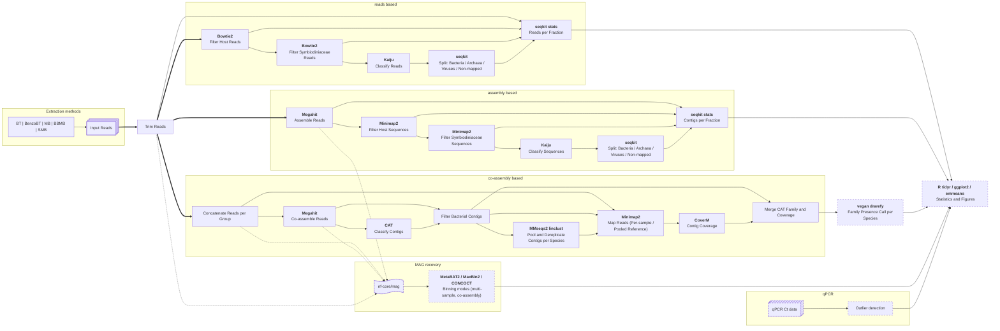

# metaG_EukDepletion

[](https://doi.org/10.5281/zenodo.19912536)
[](https://doi.org/10.5281/zenodo.23238935)

[](https://www.nextflow.io/)
[](https://apptainer.org/)
[](https://docs.conda.io/)
[](mag_recovery/README.md)
[](LICENSE)

Nextflow pipeline and R analysis for *A Field-Compatible Workflow for Host and Algal Symbiont Depletion Enables Effective Prokaryotic Enrichment for Hexacorallian Shotgun Metagenomics*. The pipeline measures how much host (Aiptasia or scleractinian coral) and Symbiodiniaceae DNA is left after each extraction method, and what remains of the prokaryotic fraction.

---

## Flowchart



Dashed nodes run outside this Nextflow pipeline: R analysis ([R-scripts/](R-scripts/README.md)), MAG recovery ([mag_recovery/](mag_recovery/README.md)) and qPCR ([qPCR/](qPCR/README.md)).

---

## Pipeline overview

`main.nf` trims the reads with Trimmomatic and runs three branches on them. Per-step diagrams are in [subworkflows/README.md](subworkflows/README.md), the output layout in [results/README.md](results/README.md).

| Branch | Subworkflow | Steps |
|---|---|---|
| Reads based | `MAP_CONSE_PE` | Bowtie2 (host) → Bowtie2 (Symbiodiniaceae) → Kaiju → bacteria / archaea / viruses / non-mapped split → seqkit stats |
| Assembly based | `MAP_CONSE_ASSEMBLY` | MEGAHIT → Minimap2 (host) → Minimap2 (Symbiodiniaceae) → Kaiju → bacteria / archaea / viruses / non-mapped split → seqkit stats |
| Co-assembly based | `CAT_WORKFLOW` | Reads grouped by species, method and buffer → MEGAHIT → CAT → read mapping of bacterial contigs (Minimap2, CoverM) → family tables |

### Input file names

FASTQ files must be named:

```text
{species}_{replicate}_{method}_{buffer}_{1,2}.fq.gz
```

`{species}` selects the host reference in [modules/bowtie2.nf](modules/bowtie2.nf) and [modules/minimap2.nf](modules/minimap2.nf):

| Code | Species | Host reference |
|---|---|---|
| `Ahemp` | *Acropora hemprichii* | Scleractinia |
| `Plob` | *Porites lobata* | Scleractinia |
| `Pver` | *Pocillopora verrucosa* | Scleractinia |
| `F003` | Aiptasia F003 | Aiptasia |
| `H2` | Aiptasia H2 | Aiptasia |

Any other code stops the run with `Invalid alignment mode`. To support it, add a branch in both modules.

---

## Requirements

- Nextflow ≥ 23.0
- Apptainer (recommended) or conda / mamba
- Bowtie2 and Minimap2 indexes of the host (Aiptasiidae, Scleractinia) and Symbiodiniaceae references
- Kaiju database (`nodes.dmp`, `names.dmp`, `.fmi` index)
- CAT database (NR)

How to download and build each of these is described in [references/README.md](references/README.md).

## Quick start

```bash
git clone https://github.com/ColinL1/metaG_EukDepletion.git
cd metaG_EukDepletion

# set the reference, database and resource paths
cp nextflow.config.example nextflow.config

nextflow run main.nf -profile apptainer \
  --input path/to/reads/ \
  --outdir path/to/results/
```

Use `-profile conda` to run with conda environments instead of containers. Adjust the CPU and memory limits in `nextflow.config` and [labels.config](labels.config) to your machine.

## After the pipeline

- **MAG recovery**: nf-core/mag 3.3.1 on the trimmed reads and assemblies from `main.nf`. See [mag_recovery/README.md](mag_recovery/README.md).
- **Figures, statistics and tables**: R scripts in [R-scripts/](R-scripts/README.md).

## Repository layout

| Folder | Content |
|---|---|
| [modules/](modules/README.md) | Nextflow processes |
| [subworkflows/](subworkflows/README.md) | The three branches |
| [references/](references/README.md) | Reference indexes and databases (not in git) |
| [results/](results/README.md) | Pipeline output (not in git) |
| [mag_recovery/](mag_recovery/README.md) | nf-core/mag settings and run scripts |
| [R-scripts/](R-scripts/README.md) | Figures, statistics and tables for the manuscript |
| [qPCR/](qPCR/README.md) | qPCR input for Figure 2 (not in git) |
| `bin/` | Helper scripts used by the pipeline |
| `assets/` | Trimmomatic adapter files |

## Data availability

MAGs (305 FASTA files), the MAG table and the qPCR raw data are on Zenodo: [10.5281/zenodo.23238935](https://doi.org/10.5281/zenodo.23238935).

## Citation

If you use this code, please cite the article and the software release. Both are listed in [CITATION.cff](CITATION.cff); GitHub shows them under **Cite this repository**.

> Colin L., Dörr M. S., Neave M., Cardenas A., Voolstra C. R. (2026). A Field-Compatible Workflow for Host and Algal Symbiont Depletion Enables Effective Prokaryotic Enrichment for Hexacorallian Shotgun Metagenomics.

Changes between releases are in [CHANGELOG.md](CHANGELOG.md).

## License

[MIT](LICENSE)
