# Collection of subworkflows used in the pipeline

## Logic

`main.nf` trims the reads and runs three subworkflows on them. Each one writes to its own folder in `${params.outdir}`.

| Subworkflow | Output folder | Steps |
|---|---|---|
| `MAP_CONSE_PE` | `reads_based/` | Bowtie2 (host) → Bowtie2 (Symbiodiniaceae) → Kaiju → split → seqkit stats |
| `MAP_CONSE_ASSEMBLY` | `assembly_based/` | MEGAHIT → Minimap2 (host) → Minimap2 (Symbiodiniaceae) → Kaiju → split → seqkit stats |
| `CAT_WORKFLOW` | `coassembly_based/` | Concatenate reads → MEGAHIT → CAT → read mapping of bacterial contigs → family tables |

### MAP_CONSE_PE and MAP_CONSE_ASSEMBLY

Reads (or assembled contigs) are mapped to the host reference, the unmapped fraction is mapped to Symbiodiniaceae, and what remains is classified with Kaiju and split into bacteria, archaea, viruses and non-mapped. Files are named `<sample>.<fraction>.<mapped|unmapped>`.

Each subworkflow ends with one `seqkit stats` table of every fraction (`stats/stats_reads.tsv`, `stats/stats_assembly.tsv`) and one Kaiju summary table. Per sample, the fractions add up to the trimmed reads (or the assembled contigs).

<details>
  <summary> MAP_CONSE_PE </summary>



</details>

<details>
  <summary> MAP_CONSE_ASSEMBLY</summary>



</details>

### CAT_WORKFLOW

Reads are grouped by species, method and buffer, concatenated and co-assembled with MEGAHIT. Contigs are classified with CAT, and the bacterial contigs are quantified by read mapping (Minimap2, CoverM) against two references, selected with `params.cat_quant_mode` (`persample`, `pooled` or `both`):

- `persample`: the bacterial contigs of the group itself.
- `pooled`: the bacterial contigs of all groups of a species, dereplicated with MMseqs2.

Each mode writes `family_table.<mode>.tsv`, `contig_table.<mode>.tsv.gz` and `mapping_summary.<mode>.tsv` to `coassembly_based/quantification/<mode>/`.

## Folder content

```text
subworkflows
├── README.md               <-- you are here.
├── CAT.nf
├── exploratory             # Outdated or undeveloped subworkflows. Not used by main.nf, no guarantees.
│   └── archived_old-logic  # Snippets from the previous version of the pipeline.
├── k2b.nf                  # Kraken2 / Bracken. Functional, not used by main.nf - superseded by Kaiju
├── map_conse_assembly.nf
└── map_conse_pe.nf
```
