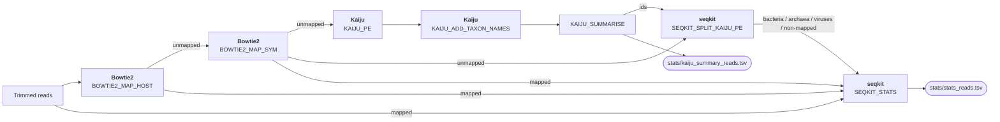
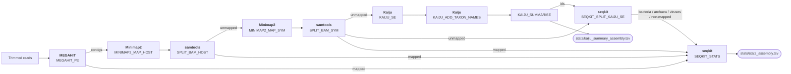

# Subworkflows

`main.nf` trims the reads and runs three subworkflows on them. Each one writes to its own folder in `${params.outdir}` (layout in [results/README.md](../results/README.md)).

| Branch | Subworkflow | Output folder | Steps |
|---|---|---|---|
| Reads based | `MAP_CONSE_PE` | `reads_based/` | Bowtie2 (host) → Bowtie2 (Symbiodiniaceae) → Kaiju → split → seqkit stats |
| Assembly based | `MAP_CONSE_ASSEMBLY` | `assembly_based/` | MEGAHIT → Minimap2 (host) → Minimap2 (Symbiodiniaceae) → Kaiju → split → seqkit stats |
| Co-assembly based | `CAT_WORKFLOW` | `coassembly_based/` | Concatenate reads → MEGAHIT → CAT → read mapping of bacterial contigs → family tables |

In the diagrams, boxes are processes (tool in bold) and rounded boxes are the tables written to `${params.outdir}`.

## Reads based: MAP_CONSE_PE

Reads are mapped to the host reference, the unmapped pairs are mapped to Symbiodiniaceae, and the pairs left over are classified with Kaiju and split into bacteria, archaea, viruses and non-mapped. Files are named `<sample>.<fraction>.<mapped|unmapped>`. Per sample, the fractions add up to the trimmed reads.



## Assembly based: MAP_CONSE_ASSEMBLY

Same steps as the reads based branch, on the contigs of a per-sample MEGAHIT assembly. Minimap2 maps the contigs and samtools splits each BAM into mapped and unmapped contigs. Per sample, the fractions add up to the assembled contigs.



## Co-assembly based: CAT_WORKFLOW

Reads are grouped by species, method and buffer, concatenated and co-assembled with MEGAHIT. Contigs are classified with CAT. The bacterial contigs are quantified by mapping the group's reads to one or both references, selected with `params.cat_quant_mode` (`persample`, `pooled` or `both`):

- `persample`: the bacterial contigs of the group itself.
- `pooled`: the bacterial contigs of all groups of a species, dereplicated with MMseqs2.

```mermaid
flowchart LR
    IN["Trimmed reads<br>grouped by species, method, buffer"]
    C["CONCAT_FASTQ"]
    A["<b>MEGAHIT</b><br>MEGAHIT_COASSEMBLY"]
    CAT["<b>CAT</b><br>CAT"]
    CN["<b>CAT</b><br>CAT_ADD_NAMES"]
    FB["<b>seqkit</b><br>CAT_FILTER_BACTERIA"]
    PF["<b>R</b><br>CAT_PREP_FAMILY"]
    PR["<b>seqkit</b><br>SEQKIT_PREFIX_CONTIGS"]
    PO["POOL_CONTIGS"]
    LC["<b>MMseqs2</b><br>MMSEQS_LINCLUST"]
    IX["<b>Minimap2</b><br>MINIMAP2_INDEX"]
    MP["<b>Minimap2</b><br>MINIMAP2_MAP_CATALOGUE"]
    CV["<b>CoverM</b><br>COVERM_CONTIG"]
    MG["<b>R</b><br>CAT_MERGE_TABLES"]
    T1(["quantification/&lt;mode&gt;/<br>family_table, contig_table, mapping_summary"])

    IN --> C --> A --> CAT --> CN
    A & CN --> FB
    FB -- bacterial contig classes --> PF
    FB -- bacterial contigs --> PR
    PR -- persample --> IX
    PR -- pooled --> PO --> LC --> IX
    C -- reads --> MP
    IX --> MP --> CV --> MG
    PF --> MG
    MG --> T1
```

Each mode writes `family_table.<mode>.tsv`, `contig_table.<mode>.tsv.gz` and `mapping_summary.<mode>.tsv` to `coassembly_based/quantification/<mode>/`.



## Folder content

```text
subworkflows
├── README.md               <-- you are here.
├── CAT.nf                  # CAT_WORKFLOW
├── map_conse_assembly.nf   # MAP_CONSE_ASSEMBLY
├── map_conse_pe.nf         # MAP_CONSE_PE
├── k2b.nf                  # Kraken2 / Bracken. Not used by main.nf, superseded by Kaiju
└── exploratory             # Outdated or undeveloped subworkflows. Not used by main.nf, no guarantees.
    └── archived_old-logic  # Snippets from the previous version of the pipeline.
```
